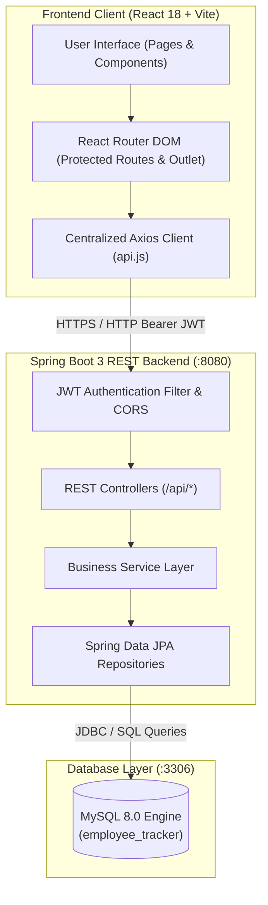

# Employee Management System

> Enterprise Workforce, Project Tracking & Operations Management Platform

[](https://www.oracle.com/java/)
[](https://spring.io/projects/spring-boot)
[](https://react.dev/)
[](https://vitejs.dev/)
[](https://www.mysql.com/)

---

## Table of Contents

- [A. Project Title and Overview](#a-project-title-and-overview)
- [B. Feature List](#b-feature-list)
- [C. Technology Stack](#c-technology-stack)
- [D. Architecture](#d-architecture)
- [E. Folder Structure](#e-folder-structure)
- [F. Database Setup](#f-database-setup)
- [G. Authentication and Authorization](#g-authentication-and-authorization)
- [H. Environment Configuration](#h-environment-configuration)
- [I. Installation Prerequisites](#i-installation-prerequisites)
- [J. How to Clone the Project](#j-how-to-clone-the-project)
- [K. How to Configure the Project After Cloning](#k-how-to-configure-the-project-after-cloning)
- [L. How to Run the Backend](#l-how-to-run-the-backend)
- [M. How to Run the Frontend](#m-how-to-run-the-frontend)
- [N. How to Make Changes to the Project](#n-how-to-make-changes-to-the-project)
- [O. Git Workflow for Making Changes](#o-git-workflow-for-making-changes)
- [P. API Documentation](#p-api-documentation)
- [Q. Testing](#q-testing)
- [R. Troubleshooting](#r-troubleshooting)
- [S. Security and Limitations](#s-security-and-limitations)
- [T. Current Status and Future Improvements](#t-current-status-and-future-improvements)
- [U. License and Contribution Information](#u-license-and-contribution-information)

---

## A. Project Title and Overview

The **Employee Management System** is a full-stack enterprise workforce portal designed for modern IT engineering organizations. It bridges HR administration with employee project execution through dedicated role-based portals.

### Why It Was Built
Traditional HR tools manage leave or payroll in isolation, while development teams manage tasks separately in issue trackers. This platform unites workforce administration, project membership, daily milestone progress logs, deadline extension requests, and leave approval workflows into a single cohesive system.

### Primary User Personas
1. **HR Administrators (`HR`)**: Oversee workforce directories, initiate IT projects, assign team members with specific project roles, distribute tasks, review extension requests, evaluate leave applications, and analyze organization-wide delivery metrics.
2. **Employees / Engineers (`EMPLOYEE`)**: View personal project assignments, interact with teammates, execute tasks, submit daily progress logs with blocker alerts, request deadline extensions, apply for leaves, and receive automated system notifications.

---

## B. Feature List

### 1. HR Administration Portal (`ROLE_HR`)
- **Dashboard Overview**: KPI cards displaying total active workforce, running projects, in-progress tasks, and pending requests (leave and deadline extensions).
- **Employee Management**:
  - Paginated employee directory with live search and status filtering (`ACTIVE`, `INACTIVE`, `ON_LEAVE`).
  - Add new employee records with automated employee codes (`EMP-XXXX`).
  - Edit designation, contact details, and employment status.
  - View detailed employee profiles with historical task logs and assigned projects.
- **Project Management**:
  - Create and configure projects with codes, target milestones, and deadlines.
  - Manage project team membership: add employees and assign project-specific roles (`LEAD`, `DEVELOPER`, `TESTER`, `DEVOPS`).
  - Remove members and monitor project completion percentages.
- **Task Orchestration**:
  - Create and assign tasks with priorities (`LOW`, `MEDIUM`, `HIGH`, `CRITICAL`), start dates, and deadlines.
  - View task execution status across teams (`TODO`, `IN_PROGRESS`, `BLOCKED`, `COMPLETED`).
- **Progress Monitoring**:
  - Real-time review of team progress updates, milestone notes, work completed, and reported blockers.
- **Deadline Extension Reviews**:
  - View pending employee extension requests with justification reasons.
  - Approve or reject extension requests with optional HR response remarks (automatic project deadline recalculation upon approval).
- **Leave Management**:
  - View, approve, or reject employee leave applications (`CASUAL`, `SICK`, `EARNED`, `MATERNITY`, `PATERNITY`).
- **Notification Alerts**:
  - View real-time alerts regarding team submissions, filter by unread status, and mark items as read.

### 2. Employee Workspace Portal (`ROLE_EMPLOYEE`)
- **Personal Workspace Dashboard**:
  - Quick metrics on personal active projects, assigned tasks, completed items, and pending requests.
- **Assigned Projects**:
  - View project details, deadlines, and active teammates.
- **Task Management & Daily Progress Logging**:
  - View assigned tasks ordered by priority and deadline.
  - Submit granular progress logs (progress %, notes, remaining work, and blocking issues).
  - Inspect historical progress timeline for any task.
- **Deadline Extension Requests**:
  - Submit formal extension requests with justification notes when project blockers occur.
  - Track review status (`PENDING`, `APPROVED`, `REJECTED`).
- **Leave Application**:
  - Apply for leaves with calendar date pickers, type selection, and reasons.
  - Monitor approval status and review remarks from HR.
- **My Work History**:
  - Searchable, chronological log of all historical progress updates and reported blockers.
- **User Profile & Notifications**:
  - View personal contact credentials, designation, employee code, and system alerts.

---

## C. Technology Stack

### Backend
- **Language**: Java 17 (LTS)
- **Framework**: Spring Boot 3.2.5
- **Build Tool**: Apache Maven 3.8+ (includes Maven Wrapper `mvnw`)
- **ORM / Persistence**: Spring Data JPA / Hibernate 6
- **Database Driver**: MySQL Connector/J 8.3.0
- **Security**: Spring Security 6, JWT (`jjwt` 0.11.5)
- **Password Verification**: Standard Java `MessageDigest` SHA-256 with constant-time equality check

### Frontend
- **Framework / Runtime**: React 18.3.1
- **Tooling & Bundler**: Vite 5.4.9
- **Language**: JavaScript (ES2022+ / JSX)
- **Routing**: React Router DOM 6.27.0
- **HTTP Client**: Axios 1.7.7 (configured with centralized interceptors)
- **Icons**: Lucide React 0.453.0
- **Charts**: Chart.js 4.4.4 & React-Chartjs-2 5.2.0

### Database & Environment
- **Database Engine**: MySQL 8.0+
- **Database Name**: `employee_tracker`
- **Default Frontend Port**: `5173` (with proxy to port `8080`)
- **Default Backend Port**: `8080`

---

## D. Architecture

The system follows a decoupled Single Page Application (SPA) and REST API architecture.



### Request Flow
1. **Client Request**: The browser interacts with React components. Axios attaches the stored JWT (`Bearer <token>`) from `localStorage`.
2. **Security & Validation**: Spring Security's `JwtAuthenticationFilter` validates token integrity and loads user authorities into the `SecurityContext`.
3. **Controller Execution**: The request is routed to role-restricted endpoints (`@PreAuthorize("hasRole('HR')")` or shared).
4. **Service & Persistence**: Business logic executes in `@Transactional` service methods and interacts with MySQL through JPA repositories.
5. **Response & Interception**: Standardized `ApiResponse<T>` JSON objects return to the frontend. Axios response interceptors handle errors (400, 401, 403, 404, 500) and render error banners or retry actions.

---

## E. Folder Structure

```text
EMPLOYEE-MANAGEMENT-SYSTEM/
├── .gitignore                          # Single centralized root Git ignore file
├── .env.example                        # Root environment variables template
├── README.md                           # Master project documentation
│
├── frontend/                           # React + Vite Client Application
│   ├── index.html                      # HTML entry template
│   ├── package.json                    # Frontend dependencies and scripts
│   ├── package-lock.json               # Deterministic dependency lockfile
│   ├── vite.config.js                  # Vite server & /api proxy configuration
│   ├── .env.example                    # Frontend environment template
│   └── src/
│       ├── main.jsx                    # React DOM root entry
│       ├── App.jsx                     # Route declarations and ErrorBoundary
│       ├── components/                 # Reusable UI widgets
│       │   ├── ErrorBoundary.jsx       # Component failure recovery wrapper
│       │   ├── EmptyState.jsx          # Zero-data presentation view
│       │   ├── LoadingSpinner.jsx      # Async state progress indicator
│       │   ├── Modal.jsx               # Accessible dialog container
│       │   ├── PageHeader.jsx          # Standardized view banner
│       │   ├── ProtectedRoute.jsx      # Role & session routing guard
│       │   ├── Sidebar.jsx             # Role-aware navigation drawer
│       │   ├── StatCard.jsx            # KPI metric card widget
│       │   └── TopNavbar.jsx           # Clean header with profile & notifications
│       ├── context/                    # React Context providers
│       │   ├── AuthContext.jsx         # User session & token state
│       │   └── NotificationContext.jsx # Real-time polling & unread counter
│       ├── layouts/
│       │   └── DashboardLayout.jsx     # Persistent layout (Sidebar + Outlet)
│       ├── pages/                      # Application route views
│       │   ├── Dashboard.jsx           # Role-based KPI & activity overview
│       │   ├── Employees.jsx           # HR workforce directory
│       │   ├── EmployeeProfile.jsx     # Detailed worker dossier
│       │   ├── Projects.jsx            # Project and membership board
│       │   ├── Tasks.jsx               # Task assignments & progress logs
│       │   ├── ProgressReports.jsx     # Multi-project progress breakdown
│       │   ├── ExtensionRequests.jsx   # Deadline extension management
│       │   ├── LeaveManagement.jsx     # Leave application & approval flow
│       │   ├── WorkHistory.jsx         # Employee historical timeline
│       │   ├── Notifications.jsx       # Alert center with filter tabs
│       │   ├── Profile.jsx             # Personal profile credentials
│       │   ├── Settings.jsx            # Account & theme preferences
│       │   ├── Login.jsx               # Secure sign-in with password toggle
│       │   └── NotFound.jsx            # 404 recovery page
│       ├── services/                   # Modular Axios API services
│       │   ├── api.js                  # Central Axios client & interceptors
│       │   ├── authService.js
│       │   ├── employeeService.js
│       │   ├── projectService.js
│       │   ├── taskService.js
│       │   ├── extensionService.js
│       │   ├── leaveService.js
│       │   └── notificationService.js
│       └── styles/                     # CSS stylesheets
│           ├── dashboard.css
│           ├── navbar.css
│           ├── sidebar.css
│           └── tables.css
│
├── backend/                            # Spring Boot Java REST Backend
│   ├── pom.xml                         # Maven dependencies & build configuration
│   └── src/
│       ├── main/
│       │   ├── java/com/employeetracker/
│       │   │   ├── EmployeeTrackerApplication.java  # Spring Boot main class
│       │   │   ├── config/             # Spring Security & CORS configuration
│       │   │   ├── controller/         # REST API controller endpoints
│       │   │   ├── dto/                # Request & response data transfer objects
│       │   │   ├── entity/             # JPA entity mappings
│       │   │   ├── exception/          # Global exception handlers
│       │   │   ├── repository/         # Spring Data JPA interfaces
│       │   │   ├── security/           # JWT token provider, filter & hasher
│       │   │   └── service/            # Business service implementations
│       │   └── resources/
│       │       ├── application.properties           # Active runtime configuration
│       │       └── application-example.properties   # Safe configuration template
│       └── test/
│           └── java/com/employeetracker/
│               └── security/Sha256PasswordEncoderTest.java
│
└── database/                           # MySQL Database Assets & Utilities
    ├── schema.sql                      # Complete 10-table DDL script
    ├── manual_account_setup.sql        # Manual SQL template for user creation
    ├── migration_bcrypt_to_sha256.sql  # Schema migration reference
    └── PasswordHashGenerator.java      # Standalone SHA-256 CLI hash utility
```

---

## F. Database Setup

- **Database Engine**: MySQL 8.0 or higher
- **Database Name**: `employee_tracker`
- **Character Set**: `utf8mb4` (Collation: `utf8mb4_unicode_ci`)

### 1. Execute Schema Script
Log in to MySQL and execute the provided DDL script:
```sql
CREATE DATABASE IF NOT EXISTS `employee_tracker` CHARACTER SET utf8mb4 COLLATE utf8mb4_unicode_ci;
USE `employee_tracker`;
SOURCE database/schema.sql;
```

### 2. Table Summary & Relationships

| Table | Purpose | Primary Key | Foreign Keys / Constraints |
| :--- | :--- | :--- | :--- |
| `users` | Core credentials for authentication | `id` (BIGINT) | `username` (UNIQUE), `email` (UNIQUE) |
| `hr` | Profile record for HR administrator | `id` (BIGINT) | `user_id` -> `users.id` (ON DELETE CASCADE) |
| `employees` | Profile record for employee | `id` (BIGINT) | `user_id` -> `users.id` (ON DELETE CASCADE), `employee_code` (UNIQUE) |
| `projects` | IT projects managed by HR | `id` (BIGINT) | `created_by_hr_id` -> `hr.id`, `project_code` (UNIQUE) |
| `project_members`| Team assignments and project roles | `id` (BIGINT) | `project_id` -> `projects.id`, `employee_id` -> `employees.id` |
| `tasks` | Project task assignments | `id` (BIGINT) | `project_id` -> `projects.id`, `assigned_employee_id` -> `employees.id`, `created_by_hr_id` -> `hr.id` |
| `progress_updates`| Immutable milestone work logs | `id` (BIGINT) | `task_id` -> `tasks.id`, `employee_id` -> `employees.id` |
| `extension_requests`| Project deadline extension reviews| `id` (BIGINT) | `project_id` -> `projects.id`, `requested_by_employee_id` -> `employees.id`, `reviewed_by_hr_id` -> `hr.id` |
| `leave_requests` | Employee leave applications | `id` (BIGINT) | `employee_id` -> `employees.id`, `reviewed_by_hr_id` -> `hr.id` |
| `notifications` | Role & user-specific alerts | `id` (BIGINT) | `recipient_user_id` -> `users.id` (ON DELETE CASCADE) |

### 3. Creating Accounts Manually
Because no default production credentials are hardcoded into the repository, create accounts using the utility:

1. Compile and run the standalone hash generator:
   ```bash
   cd database
   javac PasswordHashGenerator.java
   java PasswordHashGenerator YourSecurePassword
   ```
2. Copy the resulting 64-character lowercase hexadecimal hash.
3. Open [`database/manual_account_setup.sql`](database/manual_account_setup.sql) and substitute `<HR_SHA256_HASH>` and `<EMPLOYEE_SHA256_HASH>`.
4. Run the queries in MySQL Workbench or via the MySQL CLI.

---

## G. Authentication and Authorization

### User Model Architecture
Authentication data and business profile data are decoupled:
- **`users` Table**: Contains `username`, `email`, `password_hash`, `role` (`HR` or `EMPLOYEE`), and `enabled`.
- **`hr` Table**: Contains personal attributes for HR personnel, referencing `users.id`.
- **`employees` Table**: Contains personal attributes for developers/engineers, referencing `users.id`.

### Password Hashing Notice
> [!IMPORTANT]
> The current system utilizes standard Java `MessageDigest` **SHA-256** (with constant-time comparison). This implementation is intended for **development and educational purposes**.
> For production environments, it is strongly recommended to transition to an adaptive, salted password hashing algorithm such as **BCrypt** (`BCryptPasswordEncoder`) or **Argon2id**.

### JWT Authentication Flow
1. Client sends a `POST /api/auth/login` request with identifier and password.
2. `AuthService` verifies the user credentials against MySQL.
3. Upon success, a signed JWT token is issued (default expiration: 24 hours).
4. The frontend stores the token in browser `localStorage` under `employee_tracker_token`.
5. Axios attaches the token as `Authorization: Bearer <token>` on all subsequent requests.
6. Frontend `ProtectedRoute` guards views by decoding and verifying role access.

---

## H. Environment Configuration

### Summary of Environment Variables

| Variable | Target | Description | Default / Example | Required |
| :--- | :--- | :--- | :--- | :--- |
| `DB_URL` | Backend | JDBC Connection URL to MySQL | `jdbc:mysql://localhost:3306/employee_tracker` | Optional in dev |
| `DB_USERNAME` | Backend | MySQL database user | `root` | Optional in dev |
| `DB_PASSWORD` | Backend | MySQL database password | None | **Required** |
| `JWT_SECRET` | Backend | 256-bit hexadecimal or Base64 secret key | Pre-configured dev key | **Required in prod** |
| `JWT_EXPIRATION_MS` | Backend | Token validity period in ms | `86400000` (24h) | Optional |
| `SERVER_PORT` | Backend | Port for Spring Boot HTTP server | `8080` | Optional |
| `VITE_API_BASE_URL` | Frontend | Target API endpoint URL | `http://localhost:8080/api` | Optional (dev proxy) |

### Setup via `.env`
Create a `.env` file at the root or within `backend` / `frontend`:
```env
# Database Settings
DB_URL=jdbc:mysql://localhost:3306/employee_tracker?createDatabaseIfNotExist=true&useSSL=false&allowPublicKeyRetrieval=true&serverTimezone=UTC
DB_USERNAME=root
DB_PASSWORD=your_actual_db_password

# JWT Security
JWT_SECRET=your_custom_256_bit_hex_signing_secret_here
JWT_EXPIRATION_MS=86400000

# Frontend URL
VITE_API_BASE_URL=http://localhost:8080/api
```

---

## I. Installation Prerequisites

Ensure the following runtimes are installed:

- **Git**: `git --version` (2.30+)
- **Java Development Kit (JDK)**: `java -version` (JDK 17 LTS recommended)
- **Apache Maven**: `mvn -version` (3.8+; or use the included `mvnw`)
- **Node.js & npm**: `node -v` (v18.0.0+), `npm -v` (v9.0.0+)
- **MySQL Server**: `mysql --version` (MySQL 8.0+)
- **MySQL Workbench** *(optional, recommended for schema management)*

---

## J. How to Clone the Project

```bash
# Clone the repository
git clone <YOUR_GITHUB_REPOSITORY_URL>

# Navigate into project directory
cd "EMPLOYEE MANAGEMENT SYSTEM"

# Verify remote configuration
git remote -v
```

---

## K. How to Configure the Project After Cloning

Follow these sequential steps on a clean environment:

1. **Clone the repository** as shown above.
2. **Install Frontend Dependencies**:
   ```bash
   cd frontend
   npm install
   cd ..
   ```
3. **Configure Environment Files**:
   - Copy `.env.example` to `.env` at the root, or configure your shell environment variables.
4. **Prepare the Database**:
   - Ensure your MySQL server service is active.
   - Run `database/schema.sql` to initialize tables.
5. **Set Up an Administrator Account**:
   - Compile and execute `database/PasswordHashGenerator.java`.
   - Run the insert statements in `database/manual_account_setup.sql`.
6. **Start Backend & Frontend Services** (documented below).
7. **Access the Application**:
   - Navigate to `http://localhost:5173/login`.

---

## L. How to Run the Backend

Navigate to the `backend` directory and execute:

```powershell
# Using installed Maven
cd backend
mvn spring-boot:run
```

*(Alternatively, if environment variables are not pre-set in your shell, pass them inline:)*
```powershell
mvn spring-boot:run "-Dspring-boot.run.arguments=--spring.datasource.password=your_db_password"
```

### Expected Output
When the backend starts successfully, the console displays:
```text
Tomcat started on port 8080 (http) with context path ''
Started EmployeeTrackerApplication in X.XXX seconds
```

---

## M. How to Run the Frontend

Navigate to the `frontend` directory and start the Vite development server:

```powershell
cd frontend
npm install
npm run dev
```

### Expected Output
```text
  VITE v5.4.9  ready in 450 ms

  ➜  Local:   http://localhost:5173/
  ➜  Network: use --host to expose
```

Open `http://localhost:5173` in any modern web browser.

---

## N. How to Make Changes to the Project

### Adding a New Frontend View
1. Create your component in `frontend/src/pages/MyNewPage.jsx`.
2. Register the route in `frontend/src/App.jsx` under the `DashboardLayout` children:
   ```jsx
   <Route path="my-new-page" element={<MyNewPage />} />
   ```
3. Add the navigation item in `frontend/src/components/Sidebar.jsx` (under `hrNavItems` or `employeeNavItems`).
4. Create corresponding API methods in `frontend/src/services/`.

### Adding a New Backend Feature
1. **Entity**: Create a JPA entity class in `com.employeetracker.entity`.
2. **Repository**: Create a Spring Data repository interface in `com.employeetracker.repository`.
3. **DTO**: Define request and response DTOs in `com.employeetracker.dto`.
4. **Service**: Implement business logic in `com.employeetracker.service`.
5. **Controller**: Expose REST endpoints in `com.employeetracker.controller`.
6. **Security**: Add role checks using `@PreAuthorize("hasRole('HR')")` or customize `SecurityConfig.java`.

---

## O. Git Workflow for Making Changes

```bash
# 1. Verify working directory is clean
git status

# 2. Create and switch to a dedicated feature branch
git switch -c feature/add-attendance-tracking

# 3. Make changes and verify build
cd frontend && npm run build
cd ../backend && mvn test-compile

# 4. Stage and commit changes (verify no .env or build outputs are staged)
git status
git add .
git commit -m "feat(attendance): introduce employee check-in API and view"

# 5. Push feature branch and open a Pull Request
git push -u origin feature/add-attendance-tracking
```

---

## P. API Documentation

### 1. Authentication Module (`/api/auth`)
| Method | Endpoint | Role | Description |
| :--- | :--- | :--- | :--- |
| `POST` | `/api/auth/login` | Public | Authenticates credentials, returns JWT token & user info |
| `GET` | `/api/auth/me` | Authenticated | Retrieves current authenticated session details |

### 2. Dashboard Module (`/api/dashboard`)
| Method | Endpoint | Role | Description |
| :--- | :--- | :--- | :--- |
| `GET` | `/api/dashboard/hr` | `HR` | Organization-wide metrics, overdue tasks, pending reviews |
| `GET` | `/api/dashboard/employee` | `EMPLOYEE` | Personal project status, assigned tasks, pending requests |

### 3. Employee Module (`/api/employees`)
| Method | Endpoint | Role | Description |
| :--- | :--- | :--- | :--- |
| `GET` | `/api/employees` | `HR` | Paginated employee list with search and status filters |
| `GET` | `/api/employees/{id}` | `HR` | Comprehensive profile dossier with projects and task logs |
| `POST` | `/api/employees` | `HR` | Creates a new employee record |
| `PUT` | `/api/employees/{id}` | `HR` | Updates an existing employee profile |
| `DELETE`| `/api/employees/{id}` | `HR` | Deactivates or removes an employee |
| `GET` | `/api/employees/all` | `HR` | Unpaginated concise list of active employees |
| `GET` | `/api/employees/me` | `EMPLOYEE` | Current employee profile record |

### 4. HR Profile Module (`/api/hr`)
| Method | Endpoint | Role | Description |
| :--- | :--- | :--- | :--- |
| `GET` | `/api/hr/me` | `HR` | Current HR profile information |
| `PUT` | `/api/hr/profile` | `HR` | Updates HR profile contact details |

### 5. Project Module (`/api/projects`)
| Method | Endpoint | Role | Description |
| :--- | :--- | :--- | :--- |
| `GET` | `/api/projects` | Authenticated | Lists all projects (or assigned projects for employees) |
| `GET` | `/api/projects/{id}` | Authenticated | Retrieves project details and team member list |
| `POST` | `/api/projects` | `HR` | Creates a new project |
| `PUT` | `/api/projects/{id}` | `HR` | Updates project details and deadlines |
| `DELETE`| `/api/projects/{id}` | `HR` | Deletes a project |
| `POST` | `/api/projects/{id}/members` | `HR` | Assigns an employee to the project with a role |
| `DELETE`| `/api/projects/{id}/members/{empId}` | `HR` | Removes an employee from project membership |

### 6. Task & Progress Module (`/api/tasks`)
| Method | Endpoint | Role | Description |
| :--- | :--- | :--- | :--- |
| `GET` | `/api/tasks` | Authenticated | Lists tasks (filtered by user assignment if employee) |
| `GET` | `/api/tasks/{id}` | Authenticated | Retrieves task details |
| `POST` | `/api/tasks` | `HR` | Creates a task and assigns it to an employee |
| `PUT` | `/api/tasks/{id}` | `HR` | Modifies task parameters |
| `DELETE`| `/api/tasks/{id}` | `HR` | Removes a task |
| `POST` | `/api/tasks/{id}/progress` | `EMPLOYEE` | Submits a daily progress log with blockers |
| `GET` | `/api/tasks/{id}/progress` | Authenticated | Historical progress log for a task |
| `GET` | `/api/tasks/progress/my` | `EMPLOYEE` | Current employee's complete historical work logs |

### 7. Deadline Extension Module (`/api/extension-requests`)
| Method | Endpoint | Role | Description |
| :--- | :--- | :--- | :--- |
| `GET` | `/api/extension-requests` | `HR` | Lists all extension requests with status filters |
| `GET` | `/api/extension-requests/my` | `EMPLOYEE` | Lists extension requests created by current user |
| `POST` | `/api/extension-requests` | `EMPLOYEE` | Submits a new project deadline extension request |
| `PATCH`| `/api/extension-requests/{id}/review` | `HR` | Approves or rejects request with remarks |

### 8. Leave Management Module (`/api/leaves`)
| Method | Endpoint | Role | Description |
| :--- | :--- | :--- | :--- |
| `GET` | `/api/leaves` | `HR` | Lists all leave requests across the company |
| `GET` | `/api/leaves/my` | `EMPLOYEE` | Lists personal leave requests |
| `POST` | `/api/leaves` | `EMPLOYEE` | Submits a new leave application |
| `PATCH`| `/api/leaves/{id}/review` | `HR` | Approves or rejects leave application |

### 9. Notification Module (`/api/notifications`)
| Method | Endpoint | Role | Description |
| :--- | :--- | :--- | :--- |
| `GET` | `/api/notifications` | Authenticated | Returns notifications and unread counter |
| `PATCH`| `/api/notifications/{id}/read` | Authenticated | Marks a single notification as read |
| `PATCH`| `/api/notifications/read-all` | Authenticated | Marks all notifications as read |

---

## Q. Testing

### Backend Unit Tests
Execute the test suite using Maven:
```powershell
cd backend
mvn test
```
The project includes unit tests for `Sha256PasswordEncoder` and authentication validation in `backend/src/test/java/`.

### Frontend Build Verification
Verify TypeScript/JSX syntax, imports, and bundling:
```powershell
cd frontend
npm run build
```
Production assets are generated in `frontend/dist/`.

---

## R. Troubleshooting

### 1. Port 8080 or Port 5173 Collision (Windows)
Find the process ID holding the port:
```cmd
netstat -ano | findstr :8080
tasklist /FI "PID eq <PID_FROM_NETSTAT>"
```
Terminate the process only if it is safe to do so:
```cmd
taskkill /PID <PID> /F
```

### 2. MySQL Connection Failure (`Communications link failure`)
- Confirm that the MySQL service is running (`services.msc` -> `MySQL80`).
- Ensure credentials in `application.properties` or environment variables match your local database.
- Verify that `employee_tracker` exists:
  ```sql
  SHOW DATABASES LIKE 'employee_tracker';
  ```

### 3. Password Verification Failure on Login
- Passwords must be hashed using the exact lowercase hexadecimal SHA-256 representation.
- Use `database/PasswordHashGenerator.java` to generate valid hashes.

### 4. React "Network Error" on Sign-In
- Verify that the Spring Boot backend is active on port `8080`.
- Verify that the browser connects to `http://localhost:5173`.
- Inspect the browser console for CORS error messages.

---

## S. Security and Limitations

1. **Never Commit Secrets**: Keep `.env`, `application-local.properties`, private keys, and credential backups out of Git. The centralized root `.gitignore` enforces this automatically.
2. **Rotate Discovered Secrets**: If any secret was committed in past Git revisions, assume it is compromised and rotate it immediately.
3. **Password Hashing Upgrade**: Replace plain SHA-256 with **BCrypt** or **Argon2id** before deploying to any production environment.
4. **JWT Hardening**: In production, supply a 256-bit randomly generated hex string via `JWT_SECRET` and enable HTTPS.
5. **CORS Restrictions**: Limit `allowedOrigins` in `SecurityConfig.java` strictly to authorized production domains.

---

## T. Current Status and Future Improvements

### Implemented & Verified
- Complete HR workforce administration, employee dossier, and project management.
- Task orchestration with status lifecycle (`TODO`, `IN_PROGRESS`, `BLOCKED`, `COMPLETED`).
- Employee daily milestone progress updates with blocker flags.
- Formal deadline extension and leave request review workflows.
- Role-protected routing, Error Boundaries, responsive layouts, and notification polling.

### Recommended Future Enhancements
- Upgrade password hashing from SHA-256 to BCrypt with configurable work factor.
- Refresh token mechanism with sliding expiration.
- File attachment uploads for leave doctor notes and task deliverables.
- Real-time WebSocket notifications replacing HTTP polling.

---

## U. License and Contribution Information

### License
This repository does not currently have a predefined public open-source license. All rights are reserved by the original project contributors.

### Contributing
1. Fork the repository.
2. Create a clean feature branch (`git switch -c feature/your-feature-name`).
3. Commit your changes with clear messages (`git commit -m "Add feature XYZ"`).
4. Push to your branch (`git push origin feature/your-feature-name`).
5. Open a Pull Request detailing the changes and verification steps.
